<!--
╔═══════════════════════════════════════════════════════════════════════════════════╗
║                                                                                 ║
║                        CONFIGURATION — EDIT HERE                                ║
║                                                                                 ║
║   Search & Replace these values throughout the file to personalize:             ║
║                                                                                 ║
║   GITHUB_USERNAME  →  Muhammad-UmarX                                            ║
║   DISPLAY_NAME     →  Muhammad Umar           (also in assets/hero.svg)         ║
║   TAGLINE          →  Venturing the AI         (also in assets/hero.svg)        ║
║                       Dimension                (also in assets/terminal.svg)     ║
║                                                                                 ║
║   SOCIAL LINKS — replace these placeholder URLs:                                ║
║   LINKEDIN         →  https://linkedin.com/in/YOUR_LINKEDIN_USERNAME            ║
║   TWITTER/X        →  https://x.com/YOUR_TWITTER_HANDLE                        ║
║   PORTFOLIO        →  https://YOUR_PORTFOLIO_WEBSITE                            ║
║   EMAIL            →  YOUR_EMAIL@example.com                                    ║
║                                                                                 ║
║   THEME COLORS (find & replace hex codes to change theme):                      ║
║   DC143C  = crimson red (primary)                                               ║
║   FF4444  = bright red  (accent)                                                ║
║   FF6B6B  = soft red    (secondary)                                             ║
║   0d1117  = github dark (backgrounds)                                           ║
║   C9D1D9  = light gray  (text)                                                  ║
║                                                                                 ║
╚═══════════════════════════════════════════════════════════════════════════════════╝
-->

<!-- ══════════════════════════════ HERO BANNER ══════════════════════════════ -->

 

<!-- ═════════════════════════ TYPING ANIMATION ═════════════════════════ -->
<!-- Edit the 'lines' parameter to change rotating text                   -->

 

<!-- ═══════════════════════ PROFILE BADGES ═══════════════════════ -->

&nbsp;

&nbsp;

 

 

<!-- ═══════════════════════ ABOUT ME — TERMINAL CARD ═══════════════════════ -->

## 「 ABOUT ME 」

 

  

 

<!-- ═══════════════════════ TECH STACK ═══════════════════════ -->
<!-- Add/remove badges: https://img.shields.io/badge/NAME-BG?style=for-the-badge&logo=ICON&logoColor=COLOR -->
<!-- Browse logos at https://simpleicons.org                                                                  -->

## 「 TECH ARSENAL 」

 

### Languages

 

 

### AI / ML &amp; Frameworks

 

 

### Tools &amp; Testing

 

  

 

<!-- ═══════════════════════ GITHUB STATS ═══════════════════════ -->

## 「 GITHUB ANALYTICS 」

 

  

  

  

 

<!-- ═══════════════════════ CONTRIBUTION GRAPH ═══════════════════════ -->

## 「 CONTRIBUTION GRAPH 」

 

  

 

<!-- ═══════════════════════ SNAKE ANIMATION ═══════════════════════ -->
<!-- Requires GitHub Actions workflow — see SETUP.md                  -->

## 「 CONTRIBUTION SNAKE 」

 

<picture>
  <source media="(prefers-color-scheme: dark)" srcset="https://raw.githubusercontent.com/Muhammad-UmarX/Muhammad-UmarX/output/github-snake-dark.svg" />
  <source media="(prefers-color-scheme: light)" srcset="https://raw.githubusercontent.com/Muhammad-UmarX/Muhammad-UmarX/output/github-snake.svg" />
  
</picture>

  

 

<!-- ═══════════════════════ DEV QUOTE ═══════════════════════ -->

## 「 RANDOM DEV QUOTE 」

 

  

 

<!-- ═══════════════════════ SOCIAL LINKS ═══════════════════════ -->
<!-- Replace placeholder URLs below with your actual profiles     -->

## 「 CONNECT 」

 

<!-- LINKEDIN — Replace YOUR_LINKEDIN_USERNAME -->

&nbsp;&nbsp;
<!-- TWITTER/X — Replace YOUR_TWITTER_HANDLE -->
[-0d1117?style=for-the-badge&logo=x&logoColor=DC143C)](https://x.com/YOUR_TWITTER_HANDLE)
&nbsp;&nbsp;
<!-- PORTFOLIO — Replace YOUR_PORTFOLIO_WEBSITE -->

&nbsp;&nbsp;
<!-- EMAIL — Replace YOUR_EMAIL@example.com -->

  

<!-- ═══════════════════════ FOOTER ═══════════════════════ -->

  

<!--
═══════════════════════════════════════════════════════════════════
                    Made with crimson and code
═══════════════════════════════════════════════════════════════════
-->
